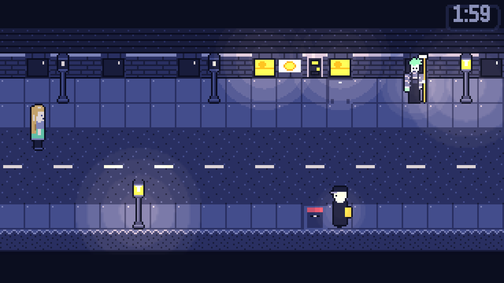

# Nightshift



Nightshift is a top-down pixel RPG for Godot 4.

Every night from 2:00 to 3:00, the town has a second shift. The workers of the
Nightshift put the day back together. They relight the lamps, return lost things
and take yesterday's bread back. Nobody awake has ever seen them, until a kid
named Tadzio wakes up at 1:59.

This repo holds a vertical slice: one full night, about 15 minutes of play.
Tadzio and Bryan design the game. Claude Code builds it from [SPEC.md](SPEC.md).

## How it plays

- **Minutes are the currency.** The clock is always on the screen. Doors, lamps
  and forms cost minutes. The clock stops while you are in a fight. At 3:00 the
  night ends, and Tadzio wakes up in bed.
- **Every worker is a job.** In a fight, you dodge the attacks. Help the worker
  with the job, and you make a friend. Hustle the worker, and you make an enemy.
- **Wick is your only friend at first.** Wick is an anxious moth lamplighter.
  He cannot fight. He can light the arena and give you more time.
- **The town forgets.** Only the things that you save at a lamp stay to the
  next night.

Nobody dies. If you lose a fight, you fall asleep.

## Play it

1. Install Godot 4.4 or newer. On macOS, use `brew install --cask godot`.
2. Open `project.godot` in Godot and push F5. Or, from a shell:

   ```sh
   /Applications/Godot.app/Contents/MacOS/Godot --path .
   ```

3. Choose **New Night**.

| Action | Keyboard | Gamepad |
|---|---|---|
| Move | Arrows, WASD | Left stick, D-pad |
| Confirm, talk, look | Z, Space, Enter | A |
| Cancel, skip text | X, Esc | B |
| Flashlight on or off | C, Tab | Y |
| Rewind (in a fight, after you get the watch) | R, Shift | Left bumper |
| Fullscreen | F11 | |

## Add to the game

All the content is in data files. You can add content without changes to the
engine.

| To add | Edit |
|---|---|
| A room | `data/rooms/<id>.json`, an ASCII map with a legend |
| Dialogue | `data/dialogue/<file>.json` |
| A worker and the fight | `data/workers/<id>.json` |
| A Help Wanted posting | `data/help_wanted.json` |
| Art | `assets/px/`, one letter for each pixel |
| Numbers to tune | `data/tuning.json` |

After you change the art, build the PNGs again:

```sh
uv run --with pillow python tools/compile_px.py
```

[DEV.md](DEV.md) has the fields of each file, a worked example for each type,
the debug keys and the export commands.

## Test it

A bot plays Night 1 without a window. It prints `AUTOTEST PASS` or
`AUTOTEST FAIL`. In these commands, `Godot` is the path to the Godot binary.

```sh
Godot --headless --path . res://dev/autotest.tscn -- route=help
```

DEV.md lists the other routes and what each one checks.

## Where things are

| Path | Contents |
|---|---|
| `src/` | GDScript for the overworld, dialogue, battles and UI |
| `data/` | Rooms, dialogue, workers, items and tuning |
| `assets/px/` | Sprites, tiles and portraits as text |
| `dev/` | Test scenes and the autotest bot |
| `tools/` | Python scripts for art, audio and playtest reports |
| [SPEC.md](SPEC.md) | The design spec |
| [DEV.md](DEV.md) | The developer notes |
| [NOTES_FOR_BRYAN.md](NOTES_FOR_BRYAN.md) | Open design questions |

## Credits

- Design: Tadzio and Bryan
- Code: Claude Code, from the spec
- Font: [m6x11](https://managore.itch.io/m6x11) by Daniel Linssen, free to use
  with attribution
- Engine: [Godot](https://godotengine.org)
- Sounds and music: `tools/gen_audio.py` makes them
